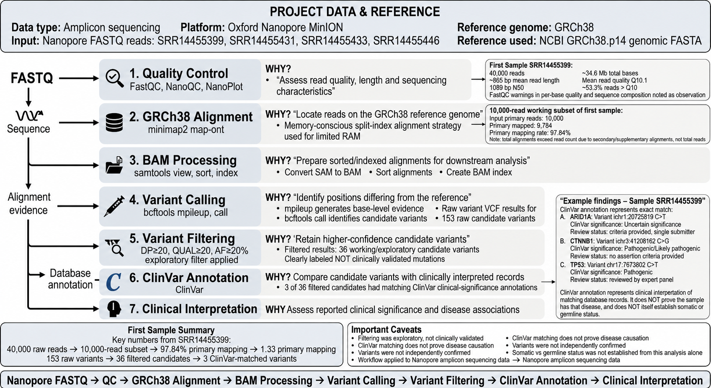

# Nanopore Amplicon Variant Analysis

A reproducible bioinformatics workflow for analysis of Oxford Nanopore amplicon sequencing data, covering quality assessment, reference alignment, BAM processing, variant calling, candidate variant filtering, and ClinVar annotation.

---

## Project Overview

This project demonstrates an end-to-end analysis workflow for Oxford Nanopore amplicon sequencing data.

The analysis starts from raw Nanopore FASTQ reads and proceeds through:

**Quality Control → Read Subsampling → GRCh38 Alignment → SAM/BAM Processing → Variant Calling → Candidate Variant Filtering → ClinVar Annotation → Interpretation**

The workflow was performed using command-line bioinformatics tools in a Linux/Ubuntu environment.

---
## Workflow



## Objectives

The main objectives of this project were to:

- Assess the quality of Oxford Nanopore sequencing reads.
- Align Nanopore reads to the human GRCh38 reference genome.
- Process alignments into sorted and indexed BAM files.
- Identify candidate variants using `bcftools`.
- Apply an exploratory variant filtering strategy.
- Compare filtered candidate variants with ClinVar.
- Interpret the reported clinical significance of matching ClinVar records.
- Organize the workflow into reproducible analysis steps.

---

## Dataset

### Sequencing Platform

- Oxford Nanopore MinION
- Sequencing type: Amplicon sequencing

Four Nanopore datasets were available:

| Sample |
|---|
| SRR14455399 |
| SRR14455431 |
| SRR14455433 |
| SRR14455446 |

The completed workflow documented in this repository currently focuses on the initial analysis of:

**SRR14455399**

A standardized 10,000-read subset was used for the initial workflow development and variant analysis.

---

## Tools Used

| Tool | Purpose |
|---|---|
| FastQC | General sequencing quality assessment |
| NanoPlot | Nanopore read length and quality assessment |
| SeqKit | FASTQ statistics and read subsampling |
| minimap2 | Alignment of Nanopore reads to GRCh38 |
| samtools | SAM/BAM processing, sorting and indexing |
| bcftools | Variant evidence generation and variant calling |
| ClinVar | Clinical variant annotation |
| Linux/Ubuntu | Command-line analysis environment |

---

## Quality Control

Quality assessment was performed using FastQC and NanoPlot. NanoQC was considered as part of the Nanopore QC workflow but its results are not included in the current analysis.

The purpose of QC was to assess read quality, read length distribution, sequencing characteristics, and potential technical issues before downstream analysis.

### SRR14455399 QC Summary

| Metric | Result |
|---|---:|
| Number of reads | 40,000 |
| Total bases | 34,595,009 |
| Mean read length | 864.9 bp |
| Median read length | 692 bp |
| N50 | 1,098 bp |
| Mean quality | Q10.1 |
| Reads > Q10 | 62.5% |
| Reads > Q15 | ~0% |
| Reads > Q20 | 0 |
| GC content | ~53.3% |
| Longest read | 7,428 bp |

FastQC reported several quality/composition warnings or failures, including per-base sequence quality, per-sequence quality scores, per-base sequence content, and overrepresented sequences.

These QC observations were treated as characteristics of the Nanopore data rather than as an automatic reason to discard the dataset.

---

## Read Subsampling

A reproducible 10,000-read working subset was generated from the original FASTQ file.

The original FASTQ file was retained unchanged.

### Working Subset

| Metric | Result |
|---|---:|
| Reads | 10,000 |
| Total bases | 8,602,457 |
| Mean read length | 860.2 bp |
| Minimum read length | 80 bp |
| Maximum read length | 5,985 bp |

The 10,000-read subset represents a standardized working subset and should not be interpreted as 10,000× sequencing coverage.

---

## Reference Genome

The human reference genome used for alignment was:

**GRCh38.p14**

Reference file:

`GCF_000001405.40_GRCh38.p14_genomic.fna`

A FASTA index was generated using `samtools faidx` to enable efficient access to reference sequences during downstream analysis.

---

## Read Alignment

Nanopore reads were aligned to the GRCh38 reference genome using:

**minimap2 — `map-ont` preset**

Because the analysis was performed in a memory-limited virtual-machine environment, a split-index alignment strategy was used.

### Alignment Result

| Metric | Result |
|---|---:|
| Primary reads | 10,000 |
| Primary mapped reads | 9,784 |
| Primary mapping rate | **97.84%** |

Secondary and supplementary alignment records were also present.

The total number of alignment records should therefore not be interpreted as the number of sequencing reads because a single read can have primary, secondary, or supplementary alignments.

A high mapping rate indicates that most primary reads could be aligned to the reference, but mapping rate alone does not establish alignment correctness or variant validity.

---

## SAM/BAM Processing

The alignment files were processed using `samtools`.

The workflow included:

- SAM to BAM conversion
- BAM sorting
- BAM indexing
- Alignment statistics

The final alignment files included:

`SRR14455399_10k.sorted.bam`

`SRR14455399_10k.sorted.bam.bai`

Sorting organizes alignments by genomic position, while the BAM index enables efficient access to specific genomic regions.

---

## Variant Calling

Variant calling was performed using:

- `bcftools mpileup`
- `bcftools call`

`bcftools mpileup` was used to generate base-level evidence from the aligned reads.

`bcftools call` was then used to identify candidate variants.

### Result

**153 raw candidate variants** were identified.

---

## Variant Filtering

An exploratory working filter was applied using:

- **DP ≥ 20**
- **QUAL ≥ 20**
- **Alternate allele fraction ≥ 20%**

### Result

| Stage | Number of variants |
|---|---:|
| Raw candidate variants | 153 |
| Filtered candidate variants | **36** |

The filtering step was used to prioritize candidate variants supported by sufficient read depth, variant quality, and alternate allele fraction.

### Important Note

These thresholds represent an **exploratory working filter**.

They are not a clinically validated variant-filtering strategy and should not be interpreted as sufficient for clinical diagnosis.

---

## ClinVar Annotation

The filtered candidate variants were compared with the GRCh38 ClinVar database.

ClinVar is a public database containing interpretations of genomic variants and their relationships to human health and disease.

Relevant annotation fields included:

- `CLNSIG`
- `CLNDN`
- `GENEINFO`
- `CLNREVSTAT`
- `CLNHGVS`

Chromosome naming conventions were normalized before annotation because the candidate VCF and ClinVar database used different chromosome identifiers.

---

## ClinVar Results

Of the 36 filtered candidate variants:

**3 had matching ClinVar clinical-significance annotations.**

| Gene | Variant | DP | ClinVar Significance |
|---|---|---:|---|
| ARID1A | chr1:26729693 C>T | 67 | Uncertain significance |
| CTNNB1 | chr3:41224622 C>G | 273 | Pathogenic/Likely pathogenic |
| TP53 | chr17:7673802 C>T | 238 | Pathogenic |

### ARID1A

The matching ClinVar record was classified as **Uncertain significance** and had a single-submitter review status.

### CTNNB1

The matching ClinVar record was classified as **Pathogenic/Likely pathogenic**. The matching record had no assertion criteria provided.

### TP53

The matching ClinVar record was classified as **Pathogenic** and had an expert-panel review status.

---

## Interpretation

A ClinVar match represents the clinical interpretation reported for the corresponding database record.

It does **not** by itself establish that:

- the sample has the associated disease;
- the detected variant caused disease;
- the variant is somatic;
- the variant is germline; or
- the candidate variant has been independently experimentally validated.

Therefore, the detected variants are described as **candidate variants matching ClinVar records**, rather than confirmed disease-causing or confirmed somatic mutations.

---

## Trimming

No separate adapter or quality-trimming step was performed in the current workflow.

The Nanopore reads were first assessed using quality-control tools and then taken forward for alignment.

Trimming was not included because it was not part of the workflow specified for this project.

This does not imply that Nanopore data can never require trimming. Trimming may be appropriate depending on the sequencing protocol, adapter contamination, read characteristics, and downstream analysis requirements.

---

## Primer/BED Analysis

Primer reconstruction and BED-file generation were explored during workflow development but were not included in the final project workflow.

The final workflow therefore does not depend on:

- Primer mapping
- Primer reconstruction
- Custom primer BED generation

---

## Computational Considerations

The analysis was performed in an Ubuntu virtual-machine environment with limited available memory.

A memory-conscious split-index strategy was used for minimap2 alignment to the complete GRCh38 reference.

This demonstrated the importance of considering computational resources when working with large reference genomes and sequencing datasets.

---

## Reproducibility

The project is being organized as a reproducible command-line workflow.

The repository is structured into:

- `scripts/` — analysis scripts
- `docs/` — workflow and detailed documentation
- `config/` — sample information
- `results/` — summarized results

Large sequencing and reference files are intentionally not stored in the GitHub repository.

---

## Key Results

| Analysis Stage | Result |
|---|---:|
| Raw reads | 40,000 |
| Raw bases | 34.6 Mb |
| Mean read length | 864.9 bp |
| N50 | 1,098 bp |
| Mean quality | Q10.1 |
| Working subset | 10,000 reads |
| Primary mapped reads | 9,784 |
| Primary mapping rate | **97.84%** |
| Raw candidate variants | 153 |
| Filtered candidate variants | 36 |
| ClinVar-matched candidates | 3 |

---

## Limitations

This project represents an exploratory bioinformatics workflow rather than a clinically validated diagnostic pipeline.

Important limitations include:

1. Variant filtering thresholds were exploratory.
2. A 10,000-read working subset was used for the initial analysis.
3. Mapping rate alone does not establish alignment correctness.
4. Secondary and supplementary alignments were observed.
5. ClinVar annotation does not establish disease causation in the sample.
6. Somatic versus germline status was not established.
7. Candidate variants were not independently experimentally validated.
8. The workflow was not designed as a clinical-grade reporting pipeline.

---

## Skills Demonstrated

### NGS and Bioinformatics

- Oxford Nanopore sequencing data analysis
- FASTQ quality assessment
- Long-read alignment
- SAM/BAM processing
- Variant calling
- Variant filtering
- VCF interpretation
- Clinical variant annotation

### Tools

- FastQC
- NanoQC
- NanoPlot
- SeqKit
- minimap2
- samtools
- bcftools
- ClinVar

### Computational Skills

- Linux command line
- Bash scripting
- File organization
- Compression and indexing
- Reproducible workflow development
- Computational resource management

---

## Project Status

**Initial workflow completed for SRR14455399.**

Four Nanopore samples were available for the project. The documented completed workflow currently covers the initial sample and provides a reproducible framework that can be applied to the remaining datasets.

---

## Repository Structure

```text
nanopore-amplicon-variant-analysis/
│
├── README.md
├── scripts/
├── docs/
├── config/
└── results/
