# Nanopore Amplicon Variant Analysis

## Overview

This project documents a command-line bioinformatics workflow for analysing Oxford Nanopore sequencing reads, from initial quality assessment to candidate variant identification and ClinVar annotation.

The workflow was developed in Ubuntu and combines read quality control, reproducible read subsampling, reference-guided alignment, alignment-file processing, variant calling, candidate filtering, and database-based annotation. The primary analysis documented here uses sample `SRR14455399_1.fastq.gz` and the human GRCh38.p14 reference genome.

The project emphasizes transparent reporting of the steps performed, the outputs generated at each stage, the rationale for the selected tools, and the limitations that must be considered when interpreting candidate variants.

**Scope:** Four Nanopore sample accessions were identified for the project, but the documented downstream workflow and results in this repository focus on `SRR14455399`. Results should not be assumed to apply to the other three samples.

---

## Objectives

- Assess the quality and length distribution of raw Nanopore sequencing reads.
- Create a reproducible 10,000-read subset for downstream analysis.
- Align the selected reads to the GRCh38.p14 human reference genome.
- Process and index alignment files for variant analysis.
- Identify candidate variants using BCFtools.
- Compare two candidate-filtering strategies.
- Annotate candidate variants against ClinVar and report the available clinical-significance and review-status fields.
- Preserve the original outputs and document the limitations of the analysis.

## Dataset

The project considered the following sequencing accessions:

| Sample accession | Sample label |
|---|---|
| `SRR14455399` | HCC_NANO_FF18 |
| `SRR14455431` | NSCLC_NANO_FFPE5 |
| `SRR14455433` | NSCLC_NANO_FFPE3 |
| `SRR14455446` | NSCLC_NANO_FF23 |

The primary input was `SRR14455399_1.fastq.gz`, containing 40,000 reads and approximately 34.6 million bases.

The downstream analysis used a reproducibly sampled subset of 10,000 reads. This subset was used to reduce computational demands during alignment and variant analysis; it does not represent the complete sequencing dataset.

---

## Workflow


The analysis proceeded through five main stages:

1. Raw-read quality assessment.
2. Read subsampling and reference preparation.
3. Alignment and alignment-file processing.
4. Variant calling and candidate filtering.
5. ClinVar annotation and interpretation.

## 1. Raw-read quality control

### Purpose

Quality control was performed before alignment to characterize the input data and identify potential sequencing-quality issues. Nanopore reads can vary substantially in length and quality, so read-level summaries and positional quality plots provide complementary information.

FastQC was used to generate a report containing per-base quality, per-sequence quality, sequence composition, sequence-length distribution, GC content, duplication, overrepresented-sequence, and adapter-content assessments. NanoPlot was used to visualize Nanopore-specific read-length and read-quality characteristics.

### FastQC results

**Per-base sequence quality**

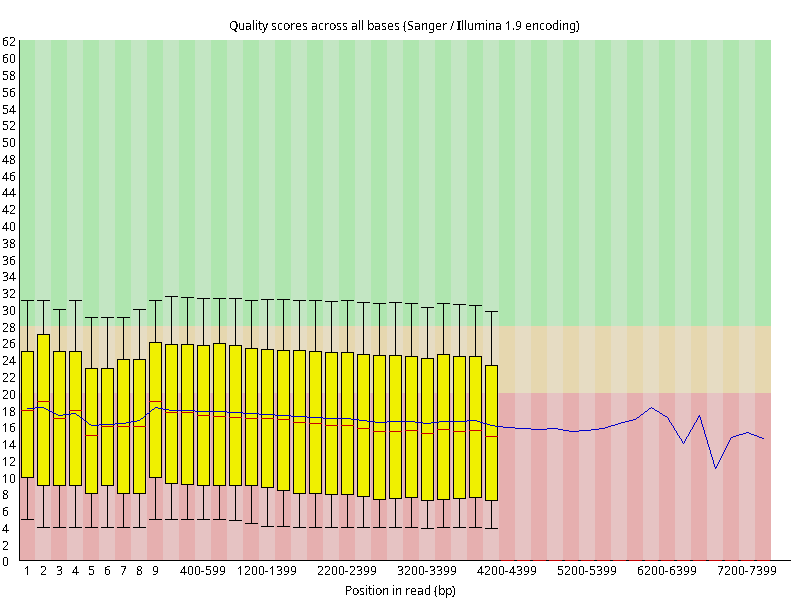

This plot displays the distribution of base-call quality scores across read positions. Variation across positions can help identify portions of reads with lower confidence. The overall assessment should be considered alongside read length and per-sequence quality.

**Per-sequence quality scores**

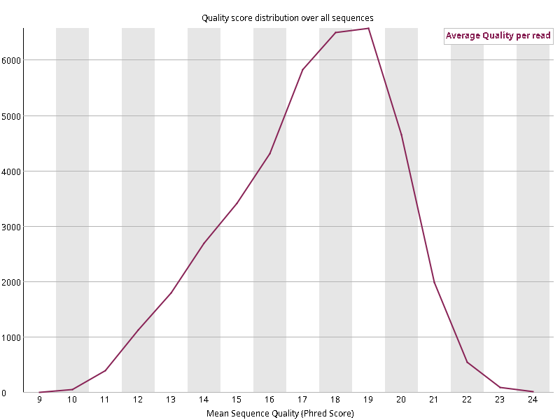

This plot summarizes the quality-score distribution across reads. It complements the per-base plot by showing whether reads as a whole tend to have high or low average quality.

**Per-base sequence composition**

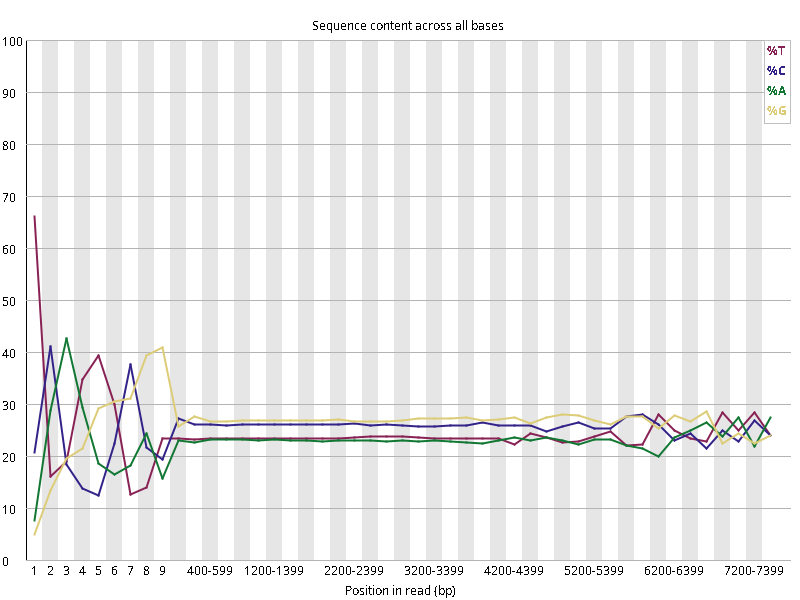

This plot assesses the distribution of A, C, G, and T across read positions. Sequence-composition patterns can reflect the biology of the library, targeted amplification, or technical effects; an unusual pattern should be interpreted in the context of the experiment rather than automatically treated as contamination.

**Sequence-length distribution**

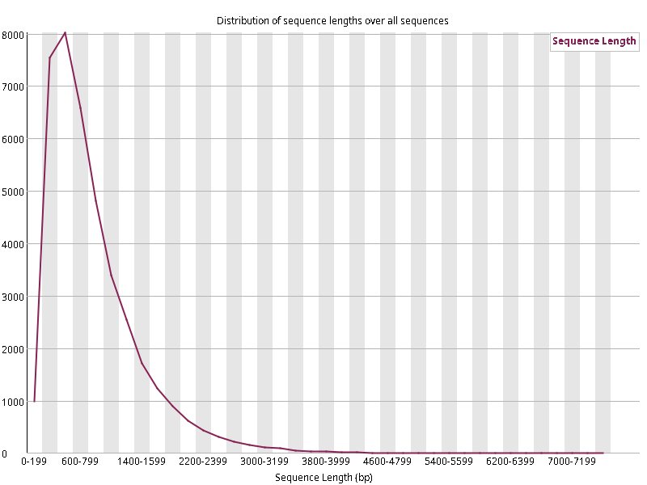

Read length is particularly relevant for Nanopore data because reads can vary substantially in length. The distribution provides context for subsequent alignment and coverage analysis.

**GC-content distribution**

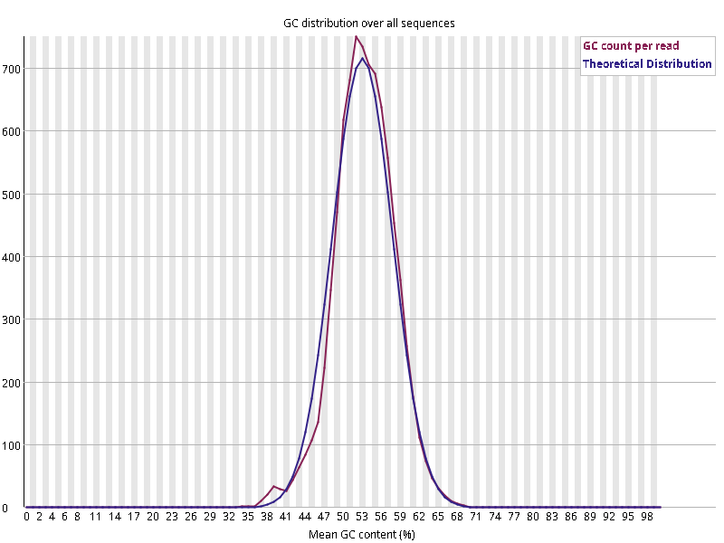

GC content provides another descriptive measure of the input sequence composition. It can help identify unusual distributions, although its interpretation depends on the expected composition of the target sequences.

**Adapter-content assessment**

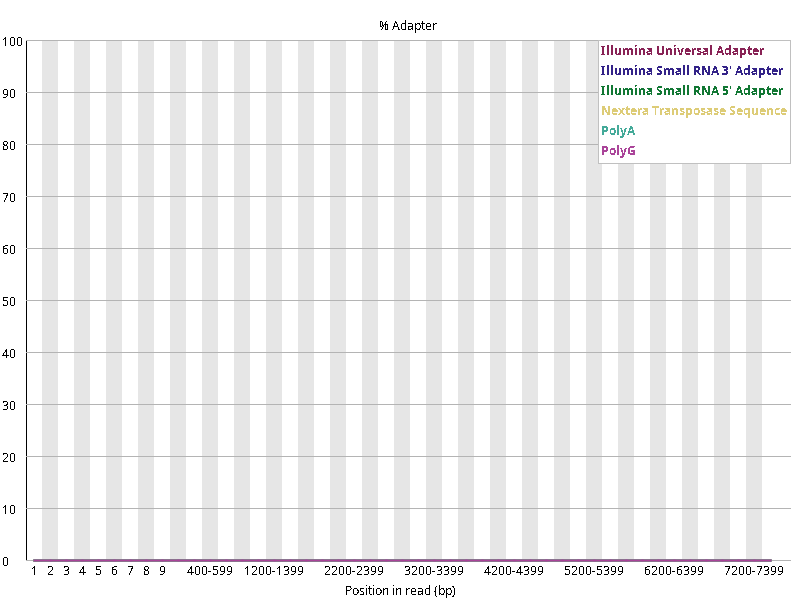

The adapter-content module assesses whether sequences resembling known adapters occur in the reads. This report was inspected as part of quality assessment; no separate adapter- or quality-trimming step was performed in the documented workflow.

### NanoPlot results

**Read length versus quality**

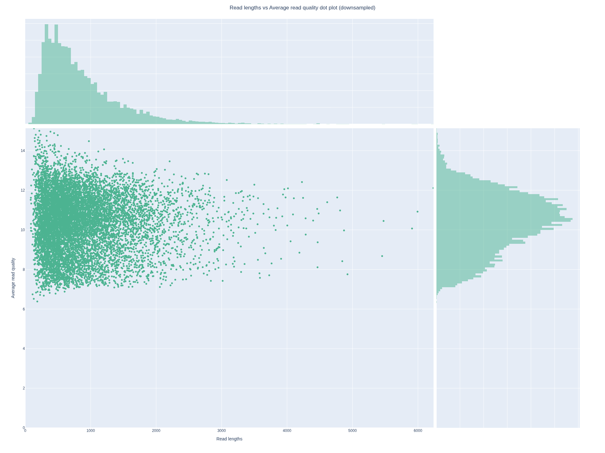

The scatter plot visualizes the relationship between read length and read quality. It allows the distribution of read lengths and quality scores to be examined together rather than treating them as independent characteristics.

**Read-length distribution**

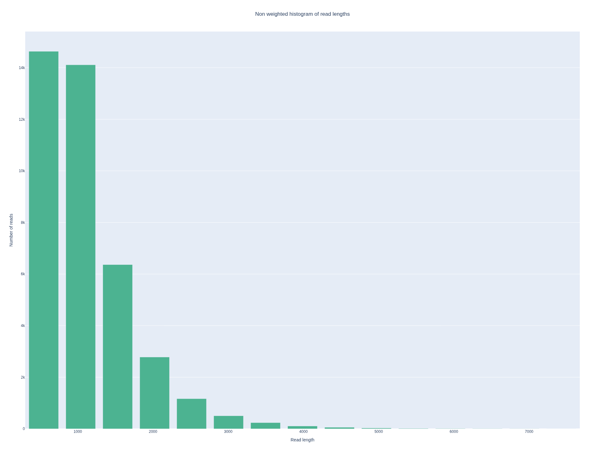

This histogram summarizes the number of reads across read-length ranges. It provides a complementary view of the read-length distribution reported by FastQC.

**Yield by read length**

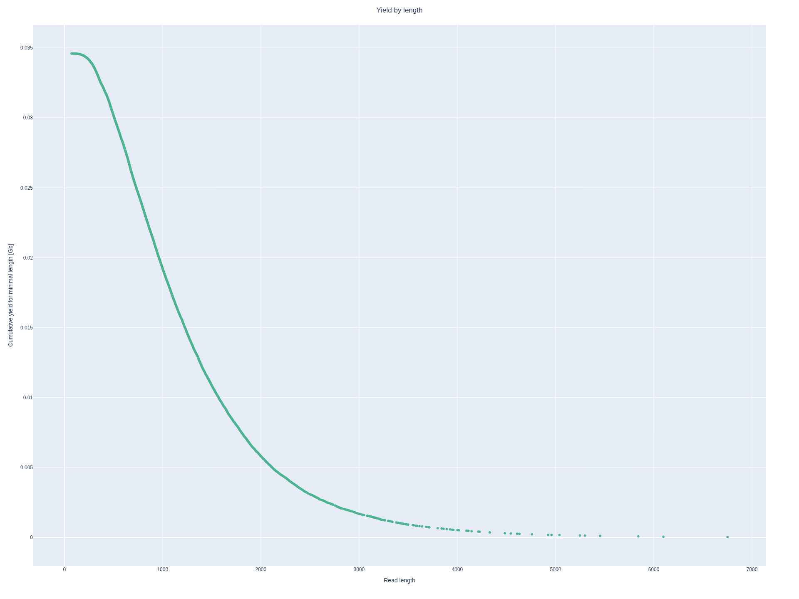

This plot shows how sequence yield is distributed across read lengths, helping distinguish the contribution of read counts from the contribution of total sequenced bases.

### Original dataset summary

The recorded NanoStats and SeqKit summaries provided the following statistics:

| Metric | Observed result |
|---|---:|
| Number of reads | 40,000 |
| Total bases | 34,595,009 |
| Mean read length | 864.9 bp |
| Median read length | 692 bp |
| Read-length N50 | 1,098 bp |
| Mean read quality | Q10.1 |
| GC content | 53.29% |

The mean quality of Q10.1 indicates that the dataset had variable base-call quality. The FastQC report also flagged per-base quality, per-sequence quality, per-base sequence content, and overrepresented sequences for further attention. These flags do not independently establish that the dataset is unusable; they identify patterns that need interpretation in the context of the sequencing method and target.

**QC interpretation:** The quality-control stage established the characteristics of the input reads before subsampling and alignment. The results were retained as evidence rather than using the QC flags alone to claim that all reads were suitable or unsuitable.

## 2. Read subsampling

### Purpose

Alignment against a whole human reference genome can be computationally demanding, especially in a virtual machine with limited memory. A subset was therefore created to test and document the downstream workflow without processing the complete read set.

SeqKit was used to sample 10,000 reads using a fixed random seed.

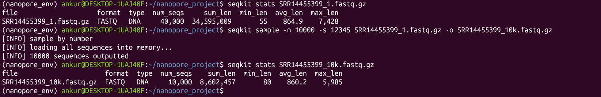

The recorded subset statistics were:

| Metric | Result |
|---|---:|
| Reads selected | 10,000 |
| Total bases | 8,602,457 |
| Mean read length | Approximately 860.2 bp |
| Minimum read length | 80 bp |
| Maximum read length | 5,985 bp |
| Sampling seed | 12345 |

The subset retained one quarter of the original read count. Because the selection was based on reproducible sampling rather than a quality threshold, it should not be described as a quality-filtered dataset.

The reduced input size made the downstream workflow more manageable in the available computational environment. However, using a subset can reduce the sensitivity of variant detection, particularly for variants supported by a small number of reads.

## 3. Reference genome preparation

### Reference selection

The NCBI GRCh38.p14 human reference assembly was used for reference-guided alignment.

- Assembly: GRCh38.p14
- NCBI accession: `GCF_000001405.40`
- Reference file: `GCF_000001405.40_GRCh38.p14_genomic.fna`

The reference was downloaded, decompressed, and indexed using SAMtools. The FASTA index enables efficient retrieval of reference sequences and supports downstream operations that require indexed reference access.

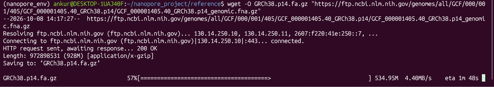

The whole-reference minimap2 index initially exceeded the available memory when attempted as a single index. A memory-conscious split-index alignment strategy was subsequently used instead. This was an environment-related adjustment; it did not change the selected reference assembly.

## 4. Read alignment

### Purpose and method

The 10,000-read subset was aligned to the GRCh38.p14 reference genome using minimap2 with the `map-ont` preset, which is intended for Oxford Nanopore reads.

The split-index strategy was used to accommodate the available memory. The alignment output was written to SAM format and subsequently processed with SAMtools.

The principal operations were:

1. Align the subsampled reads to the reference.
2. Convert the SAM output to BAM format.
3. Sort the BAM file by reference coordinate.
4. Index the sorted BAM file.
5. Inspect alignment statistics using `samtools flagstat`.

The sorted and indexed BAM provides an efficient input for downstream variant calling.

### Alignment statistics

The recorded `samtools flagstat` output contained:

| Metric | Count |
|---|---:|
| Total alignment records | 53,717 |
| Primary alignment records | 10,000 |
| Primary mapped reads | 9,784 |
| Primary mapping rate | 97.84% |
| Secondary alignment records | 13,774 |
| Supplementary alignment records | 29,943 |

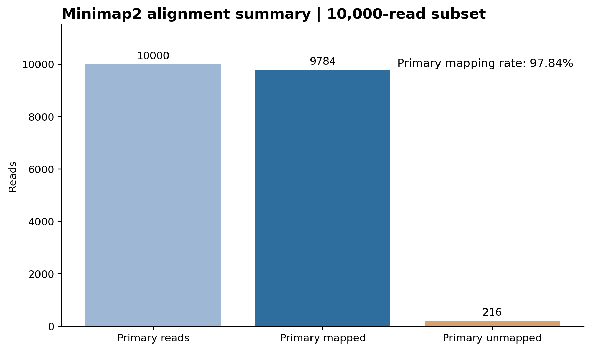

The primary mapping rate was calculated as:

`9,784 / 10,000 × 100 = 97.84%`

The 53,717 total alignment records must not be interpreted as 53,717 separate input reads. The SAM/BAM output includes secondary and supplementary alignments in addition to primary alignments.

The relatively large number of supplementary and secondary records warrants further investigation. These records can arise when a read has multiple or split alignments; the flagstat summary alone cannot determine their biological or technical cause.

Because the experiment involves targeted amplicon sequencing, whole-genome mapping statistics should not be interpreted as the sequencing depth over the intended target regions. Target-specific coverage would require a defined target-region analysis.

## 5. Variant calling

### Purpose

After alignment, BCFtools was used to identify candidate variants by comparing read evidence in the BAM file against the GRCh38.p14 reference.

The workflow used `bcftools mpileup` to summarize read evidence at genomic positions and `bcftools call -mv` to generate candidate variant records. The initial calls were written to a VCF file for inspection and filtering.

The initial VCF contained **153 candidate variant records**.

These records are computational calls generated from the selected reads. They should not automatically be treated as confirmed mutations, clinically significant variants, or disease-causing changes.

## 6. Candidate filtering and threshold comparison

### Why filtering was performed

Raw variant-calling output can include candidates with limited read support or lower caller confidence. Filtering was used to retain candidates meeting specified read-depth, quality, and alternate-allele-fraction thresholds.

Two filtering strategies were evaluated. The initial thresholds were conservative exploratory choices; after discussion with the project senior, the depth and quality thresholds were revised to retain a broader set of candidates.

### Original filtering strategy

The initial filter required:

- `DP ≥ 20`
- `QUAL ≥ 20`
- Alternate allele fraction `≥ 0.20`

This retained **36 candidate records** from the 153 initial calls.

### Revised filtering strategy

The revised filter used:

- `DP ≥ 2`
- `QUAL ≥ 7`
- Alternate allele fraction `≥ 0.20`

This retained **92 candidate records**.

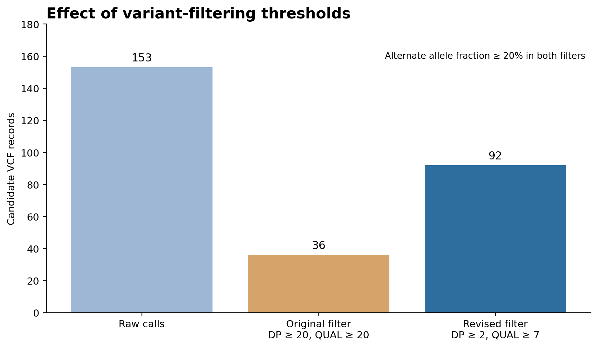

| Filtering stage | DP threshold | QUAL threshold | Alternate allele fraction | Candidates retained |
|---|---:|---:|---:|---:|
| Initial calls | — | — | — | 153 |
| Original filter | ≥ 20 | ≥ 20 | ≥ 20% | 36 |
| Revised filter | ≥ 2 | ≥ 7 | ≥ 20% | 92 |

The revised filter retained 56 more candidate records than the original filter. This demonstrates the effect of lowering the thresholds; it does not demonstrate that all additional candidates are reliable.

The DP threshold of 2 permits calls with very limited read coverage. Such calls are especially vulnerable to sequencing errors and sampling variability. The revised candidates therefore require further quality assessment, including examination of read support, alignment quality, strand or read-orientation evidence where applicable, and the relevant genomic context.

The two filtering results were preserved separately so the effect of the threshold change can be reported transparently.

## 7. ClinVar annotation

### Purpose

ClinVar is a public database that aggregates submitted interpretations of the relationship between human genetic variants and health conditions. Annotation adds existing database information to candidate variants; it does not independently validate the sequencing calls or establish a diagnosis for the sample.

The revised VCF was prepared with chromosome names compatible with the downloaded ClinVar GRCh38 VCF and then annotated using BCFtools. The annotation fields included:

- `CLNSIG`: clinical significance
- `CLNDN`: associated condition names, where available
- `GENEINFO`: gene information, where available
- `CLNREVSTAT`: review status
- `CLNHGVS`: HGVS representation, where available

### Annotation results

Three candidate records received a `CLNSIG` annotation in the revised candidate set.

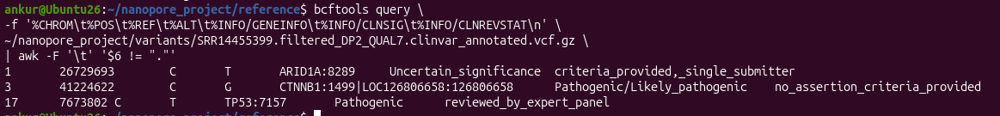

| Chromosome | Position | Change | Gene | ClinVar significance | Review status |
|---|---:|---|---|---|---|
| 1 | 26,729,693 | C>T | ARID1A | Uncertain significance | Criteria provided, single submitter |
| 3 | 41,224,622 | C>G | CTNNB1 | Pathogenic/Likely pathogenic | No assertion criteria provided |
| 17 | 7,673,802 | C>T | TP53 | Pathogenic | Reviewed by expert panel |

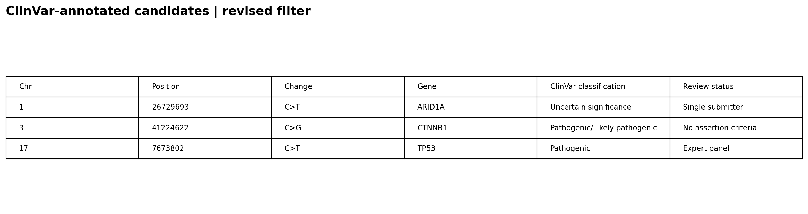

These labels describe the corresponding ClinVar annotations. They do not establish that the candidate calls are clinically confirmed in this sample.

The review statuses also differ. The ARID1A record is classified as uncertain significance with a single submitter. The CTNNB1 record has a pathogenic/likely pathogenic annotation but no assertion criteria provided in the reported field. The TP53 record is labelled pathogenic and reviewed by an expert panel.

The annotation stage does not determine whether these variants are somatic or germline. It also does not establish that any of them caused the disease associated with the sample label. Variant-level review, appropriate validation, and biological context would be needed before drawing such conclusions.

## 8. Results summary

| Stage | Main result |
|---|---|
| Raw-read QC | 40,000 reads; 34.6 million bases |
| Read subsampling | 10,000 reads retained using a fixed random seed |
| Alignment | 9,784 of 10,000 primary reads mapped |
| Primary mapping rate | 97.84% |
| Initial variant calling | 153 candidate records |
| Original filtering | 36 candidate records |
| Revised filtering | 92 candidate records |
| ClinVar annotation | 3 records with `CLNSIG` annotations |

The workflow produced a set of candidate variants and a reproducible record of the processing steps. The filtering comparison illustrates how thresholds influence the number of retained candidates, while the ClinVar stage adds existing database interpretations for a small subset of records.

The principal outcome is a documented single-sample workflow with recorded QC, alignment, filtering, and annotation results. The results should be interpreted as exploratory bioinformatics findings rather than clinically validated variant calls.

## 9. Computational environment and tools

The workflow was run in Ubuntu 26.04.1 LTS inside VirtualBox, with approximately 8 GB RAM allocated and two CPU cores.

| Tool | Version recorded | Role |
|---|---|---|
| FastQC | 0.12.1 | Raw-read quality assessment |
| NanoPlot | 1.48.0 | Nanopore-specific QC plots and statistics |
| SeqKit | 2.10.1 | FASTQ statistics and read subsampling |
| minimap2 | 2.27-r1193 | Nanopore read alignment |
| SAMtools | 1.22.1 | Alignment conversion, sorting, indexing, and statistics |
| BCFtools | 1.22 | Variant calling, filtering, and annotation |
| Git | Installed | Version control |

The reference genome was GRCh38.p14 (`GCF_000001405.40`), and the ClinVar GRCh38 VCF was used for annotation.

Additional environment details are documented in [`config/environment.md`](../config/environment.md). The methods document is available at [`docs/methods.md`](methods.md).

## 10. Reproducibility and repository contents

The repository is organized to keep documentation, original QC evidence, analysis outputs, and workflow materials separate.

```text
nanopore-amplicon-variant-analysis/
├── README.md
├── .gitignore
├── config/
│   └── environment.md
├── docs/
│   ├── workflow.png
│   ├── methods.md
│   └── images/
├── results/
│   └── results_summary.md
└── scripts/
    └── nanopore_workflow.sh
```

The `docs/images/` directory contains the original FastQC and NanoPlot plots and selected screenshots of actual command outputs. Summary graphics are used only to make recorded numerical results easier to compare.

Large sequencing files and reference/database files are not included in the repository. These can be regenerated or obtained from their original sources as needed.

## 11. Limitations

- The documented downstream analysis covers one sample and a 10,000-read subset, not the complete set of four samples.
- The subset may reduce sensitivity to low-frequency or low-support variants.
- No separate adapter- or quality-trimming step was performed in the documented workflow.
- The revised DP and QUAL thresholds are permissive; additional candidates require careful assessment.
- A high primary mapping rate does not by itself establish alignment correctness or target-specific coverage.
- Secondary and supplementary alignment records require further investigation.
- ClinVar annotation is database interpretation, not experimental validation or clinical diagnosis.
- The analysis does not establish whether the candidate variants are somatic or germline.
- No claim of clinical-grade validation is made.

## Project status

The single-sample workflow has been documented through QC, subsampling, alignment, candidate variant calling, threshold comparison, and ClinVar annotation. The repository preserves the key results and original analysis evidence to support transparent review and further development.
